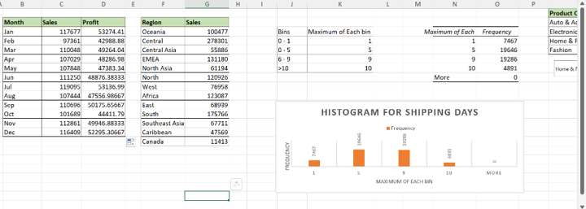

# Excel E-Commerce Sales Dashboard

## Project Overview
This project uses Microsoft Excel to analyze e-commerce sales data and visualize sales performance, profitability, regional patterns, and shipping times.

## Tools and Skills
- Microsoft Excel
- SUMIFS formulas
- Data analysis and aggregation
- Column charts and histograms
- Sales and profit reporting

## Analysis Performed
1. **Monthly Sales and Profit:** Compared monthly sales and profit performance.
2. **Regional Sales:** Analyzed sales across different geographic regions.
3. **Shipping Days:** Created a histogram to examine the distribution of shipping times.

## Project Screenshots

### 1. Monthly Sales and Profit

### 2. Region-wise Sales

### 3. Shipping Days Histogram

## Project File
[View or download the Excel workbook](Excel-Sales%20Dashboard%20Project.xlsx)

## Conclusion
This project demonstrates the use of Excel formulas and data visualization to explore e-commerce sales performance and operational patterns.
